<div align="center">

# ☸️ De Cero a Capitán en Kubernetes
### Workshop Práctico de 6 Semanas — Cloud Native Medellín 🏔️☕

[](https://kubernetes.io/es/)
[](https://github.com/)
[](./CONTRIBUTING.md)
[]()
[](https://opensource.org/licenses/MIT)

<p align="center">
  <b>Un repositorio vivo construido por y para la comunidad.</b><br>
  Aprende haciendo, rompe cosas sin miedo en tu entorno local y haz tu primer aporte al Open Source.
</p>

[☕ Guía del Tinto](./recursos/de-un-tinto-a-kubernetes.md) •
[⚓ Guía de Harbor](./recursos/guia-harbor-registry.md) •
[🛡️ Guía de Trivy](./recursos/guia-trivy-seguridad.md) •
[🤖 Guía de Ollama](./recursos/guia-ollama-ia-local.md) •
[🚀 Empezar Ahora](#paso-0-prepara-tu-laboratorio) •
[🗺️ Mapa de Ruta](#️-mapa-de-ruta) •
[🏆 Rangos y Premios](#-rangos-de-navegación-y-puntaje-gamificación) •
[🎁 Patrocinadores](#-patrocinadores-y-premios) •
[🤝 Cómo Contribuir](#-cómo-contribuir-al-repositorio)

</div>

---

> [!TIP]
> **¿Es tu primera vez usando GitHub o Kubernetes?** ¡Estás en el lugar correcto! Tu primera misión toma solo 30 segundos: regístrate en el [**Muro de Asistentes (`ASISTENTES.md`)**](./ASISTENTES.md) usando nuestro [**⛵ Formulario Visual de Registro**](https://github.com/edwinbermudez91/Fundamentos-Kubernetes/issues/new?template=registro-asistente.yml).

> [!NOTE]
> ☕ **¿Quieres entender Kubernetes con una historia 100% colombiana?**  
> Lee el guion oficial para estudiantes y speakers: [**De un Tinto Colombiano a Kubernetes (Contenedores, Pods y el Metro de Medellín)**](./recursos/de-un-tinto-a-kubernetes.md).

> [!IMPORTANT]
> 📢 **¿Hiciste Fork de este repositorio antes?**  
> El repositorio ha sido actualizado recientemente con los nuevos contenidos de Docker y mejoras en las plantillas. **Por favor sincroniza tu copia** entrando a tu repositorio en GitHub y haciendo clic en el botón **"Sync fork" ➔ "Update branch"** (o en tu terminal con `git pull origin main`).

---

## 🗺️ Mapa de Ruta

Así evolucionaremos paso a paso desde el código empaquetado con Docker hasta desplegar una arquitectura completa en Kubernetes:

```mermaid
flowchart LR
    S0["🐳 Semana 0\nFundamentos de Docker"] --> S1["🌱 Semana 1\nArquitectura y Pods"]
    S1 --> S2["🔄 Semana 2\nDeployments y Réplicas"]
    S2 --> S3["🌐 Semana 3\nServices e Ingress"]
    S3 --> S4["💾 Semana 4\nConfigMaps, Secrets y PV"]
    S4 --> S5["🛡️ Semana 5\nProbes, Recursos y RBAC"]
    S5 --> S6["🚀 Semana 6\nHelm y Proyecto Final"]

    style S0 fill:#e3f2fd,stroke:#1565c0,stroke-width:2px,color:#000
    style S1 fill:#e1f5fe,stroke:#0288d1,stroke-width:2px,color:#000
    style S2 fill:#e1f5fe,stroke:#0288d1,stroke-width:2px,color:#000
    style S3 fill:#e8f5e9,stroke:#388e3c,stroke-width:2px,color:#000
    style S4 fill:#e8f5e9,stroke:#388e3c,stroke-width:2px,color:#000
    style S5 fill:#fff3e0,stroke:#f57c00,stroke-width:2px,color:#000
    style S6 fill:#fce4ec,stroke:#c2185b,stroke-width:2px,color:#000
```



| Semana | Módulo | Lo que vas a dominar | Estado |
| :---: | :--- | :--- | :---: |
| **00** | [**De Código a Contenedor con Docker**](./semana-00-fundamentos-docker) | `Dockerfile`, imágenes OCI, ciclo de vida de contenedores y puente a Kind/K8s. | 🟢 Disponible |
| **01** | [**El motor por dentro y tu primer Pod**](./semana-01-arquitectura) | Control Plane vs. Nodos, `kubectl` y creación de Pods en YAML. | 🟢 Disponible |
| **02** | [**Despliegues sin caídas y autorreparación**](./semana-02-deployments) | ReplicaSets, Deployments, *Self-healing*, *Rolling Updates* y *Rollbacks*. | 🔜 Próximamente |
| **03** | [**Conectando todo: Redes en K8s**](./semana-03-redes) | Comunicación interna y externa: `ClusterIP`, `NodePort` e `Ingress`. | 🔜 Próximamente |
| **04** | [**Configuración y Datos Persistentes**](./semana-04-almacenamiento) | Desacoplar configuración con `ConfigMaps`, `Secrets` y volúmenes (`PVC`). | 🔜 Próximamente |
| **05** | [**Salud, Límites y Seguridad Básica**](./semana-05-operacion-seguridad) | `Liveness/Readiness Probes`, límites de CPU/RAM y permisos con `RBAC`. | 🔜 Próximamente |
| **06** | [**Empaquetado con Helm y Proyecto Final**](./semana-06-proyecto-final) | Creación de Charts básicos y despliegue de una app completa de 3 capas. | 🔜 Próximamente |

---

<a id="paso-0-prepara-tu-laboratorio"></a>

## 🛠️ Paso 0: Prepara tu Laboratorio

No necesitas tarjeta de crédito ni cuentas en la nube; todo corre en tu computador. Haz clic abajo según lo que quieras revisar:

<details>
<summary><b>💻 Ver herramientas necesarias (Checklist antes de la Clase 1)</b></summary>
<br>

1. **Contenedores:** [Docker Desktop](https://www.docker.com/products/docker-desktop/) o Docker Engine corriendo.
2. **Clúster Local:** [Kind](https://kind.sigs.k8s.io/) (recomendado por ligero) o [Minikube](https://minikube.sigs.k8s.io/).
3. **Cliente CLI:** [kubectl](https://kubernetes.io/es/docs/tasks/tools/) instalado.
4. **Editor:** [VS Code](https://code.visualstudio.com/) con la extensión oficial de **YAML** y **Kubernetes**.
5. **Gestor de Paquetes:** [Helm](https://helm.sh/) (para desplegar complementos y la consola visual [Headlamp](https://headlamp.dev/)).

👉 *¿Tienes problemas instalando alguno? Entra a [`0.prepara-tu-laboratorio`](./semana-01-arquitectura/0.prepara-tu-laboratorio) para ver guías paso a paso y plantillas de Kind.*
</details>

<details>
<summary><b>⚡ Prueba rápida: ¿Cómo sé si mi computador ya está listo?</b></summary>
<br>

Abre tu terminal y ejecuta estos comandos. Si te responden una versión sin errores, ¡estás listo para despegar!

```bash
docker --version
kind --version   # o minikube version
kubectl version --client
helm version
```
</details>

<details>
<summary><b>🌐 ¿Tu computador tiene pocos recursos? (Laboratorios interactivos en el navegador)</b></summary>
<br>

Si no puedes instalar Docker Desktop o tu máquina no tiene suficiente memoria RAM para levantar clústeres locales, puedes realizar ejercicios interactivos gratuitos directamente desde el navegador en **KodeKloud Studio**:

* 🐳 **Ejercicios de Docker:** [KodeKloud Studio — Docker Labs](https://kodekloud.com/studio/labs/docker)
* ☸️ **Ejercicios de Kubernetes:** [KodeKloud Studio — Kubernetes Labs](https://kodekloud.com/studio/labs/kubernetes)

*(No requieren tarjeta de crédito ni instalación local; incluyen terminal lista en la nube).*
</details>

---

<!-- INICIO_MOSAICO_TRIPULACION -->
## 👥 Tripulación a Bordo y Ranking (37 Tripulantes)

<div align="center">

[](./ASISTENTES.md)
[-2ea44f?style=for-the-badge&logo=github)](https://github.com/edwinbermudez91/Fundamentos-Kubernetes/issues/new?template=registro-asistente.yml)
[](https://github.com/edwinbermudez91/Fundamentos-Kubernetes/issues/new?template=registro-asistente.yml)
[](./ASISTENTES.md)

### 👨‍🏫 Capitán y Colaboradores de la Nave

<table>
  <tr>
    <td align="center" width="150">
      <a href="https://www.linkedin.com/in/edwin-bermudez-cuervo" title="Edwin Bermúdez (@edwinbermudez91)">
        <br/>
        <sub><b>Edwin Bermúdez</b></sub>
      </a><br/>
      <sub>⚓ Capitán • Instructor</sub>
    </td>
    <td align="center" width="150">
      <a href="https://www.linkedin.com/in/santiago-bedoya-diaz/" title="Santiago Bedoya Díaz (@Santiago1023)">
        <br/>
        <sub><b>Santiago Bedoya</b></sub>
      </a><br/>
      <sub>🤝 Colaborador(a)</sub>
    </td>
    <td align="center" width="150">
      <a href="https://www.linkedin.com/in/valentina-p-86b3b913a/" title="Valentina Pinzón Montoya (@vdevalen)">
        <br/>
        <sub><b>Valentina Pinzón</b></sub>
      </a><br/>
      <sub>🤝 Colaborador(a)</sub>
    </td>
    <td align="center" width="150">
      <a href="https://www.linkedin.com/in/andresqb198/" title="Andrés Quintero Bedoya (@andresqb198)">
        <br/>
        <sub><b>Andrés Quintero</b></sub>
      </a><br/>
      <sub>🤝 Colaborador(a)</sub>
    </td>
    <td align="center" width="150">
      <a href="https://www.linkedin.com/in/karengonzalezanalista/" title="Karen González (@Ka1999)">
        <br/>
        <sub><b>Karen González</b></sub>
      </a><br/>
      <sub>🤝 Colaborador(a)</sub>
    </td>
  </tr>
</table>

### 🏆 Ranking de la Tripulación (37 Tripulantes)

<table>
  <tr>
    <td align="center" width="140">
      <a href="https://www.linkedin.com/in/juandavidcorrales/" title="David Corrales (@devdavco) — 60 XP">
        <br/>
        <sub><b>🥇 David Corrales</b></sub>
      </a><br/>
      <sub>⛵ Marinero • <b>60 XP</b></sub>
    </td>
    <td align="center" width="140">
      <a href="https://www.linkedin.com/in/glgaviria" title="Gloria Gaviria (@glgaviria64) — 30 XP">
        <br/>
        <sub><b>🥈 Gloria Gaviria</b></sub>
      </a><br/>
      <sub>⛵ Marinero • <b>30 XP</b></sub>
    </td>
    <td align="center" width="140">
      <a href="https://www.linkedin.com/in/cristian-camilo-sanchez-bermudez" title="Cristian Sanchez (@ccsanchezb04) — 10 XP">
        <br/>
        <sub><b>Cristian Sanchez</b></sub>
      </a><br/>
      <sub>⛵ Marinero • <b>10 XP</b></sub>
    </td>
    <td align="center" width="140">
      <a href="https://www.linkedin.com/in/luis-tapasco/" title="Luis Tapasco (@Luistapasco) — 10 XP">
        <br/>
        <sub><b>Luis Tapasco</b></sub>
      </a><br/>
      <sub>⛵ Marinero • <b>10 XP</b></sub>
    </td>
    <td align="center" width="140">
      <a href="https://www.linkedin.com/in/dlapaz" title="Eduardo D. La paz (@VivaGarp) — 10 XP">
        <br/>
        <sub><b>Eduardo D.</b></sub>
      </a><br/>
      <sub>⛵ Marinero • <b>10 XP</b></sub>
    </td>
    <td align="center" width="140">
      <a href="https://www.linkedin.com/in/pvargasrodriguez/" title="Paola Vargas (@ypaolavar) — 10 XP">
        <br/>
        <sub><b>Paola Vargas</b></sub>
      </a><br/>
      <sub>⛵ Marinero • <b>10 XP</b></sub>
    </td>
  </tr>
  <tr>
    <td align="center" width="140">
      <a href="https://www.linkedin.com/in/juan-jose-jaramillo-a8966123a/" title="Juan Jose Jaramillo (@jujo23z) — 10 XP">
        <br/>
        <sub><b>Juan Jose</b></sub>
      </a><br/>
      <sub>⛵ Marinero • <b>10 XP</b></sub>
    </td>
    <td align="center" width="140">
      <a href="https://www.linkedin.com/in/jeraldin-caliz/" title="Jeraldin Caliz (@Jera26) — 10 XP">
        <br/>
        <sub><b>Jeraldin Caliz</b></sub>
      </a><br/>
      <sub>⛵ Marinero • <b>10 XP</b></sub>
    </td>
    <td align="center" width="140">
      <a href="https://linkedin.com/in/maria-nathali-anzola" title="Nathali Anzola (@marnathali) — 10 XP">
        <br/>
        <sub><b>Nathali Anzola</b></sub>
      </a><br/>
      <sub>⛵ Marinero • <b>10 XP</b></sub>
    </td>
    <td align="center" width="140">
      <a href="https://linkedin.com/in/kevindazar" title="Kevin Daza (@kevindazardev) — 10 XP">
        <br/>
        <sub><b>Kevin Daza</b></sub>
      </a><br/>
      <sub>⛵ Marinero • <b>10 XP</b></sub>
    </td>
    <td align="center" width="140">
      <a href="https://www.linkedin.com/in/jcrvillamizar" title="Juan Carlos Rodriguez Villamizar (@jcrvillamizar) — 10 XP">
        <br/>
        <sub><b>Juan Carlos</b></sub>
      </a><br/>
      <sub>⛵ Marinero • <b>10 XP</b></sub>
    </td>
    <td align="center" width="140">
      <a href="https://www.linkedin.com/in/airy-nc/" title="Airy Nieves (@aiops88) — 10 XP">
        <br/>
        <sub><b>Airy Nieves</b></sub>
      </a><br/>
      <sub>⛵ Marinero • <b>10 XP</b></sub>
    </td>
  </tr>
  <tr>
    <td align="center" width="140">
      <a href="https://linkedin.com/in/dupegui" title="David Upegui (@DavidUpegui) — 10 XP">
        <br/>
        <sub><b>David Upegui</b></sub>
      </a><br/>
      <sub>⛵ Marinero • <b>10 XP</b></sub>
    </td>
    <td align="center" width="140">
      <a href="https://www.linkedin.com/in/ymqc01" title="Yeison Mateo Quintero Carmona (@mateoqc123) — 10 XP">
        <br/>
        <sub><b>Yeison Mateo</b></sub>
      </a><br/>
      <sub>⛵ Marinero • <b>10 XP</b></sub>
    </td>
    <td align="center" width="140">
      <a href="https://www.linkedin.com/in/johan-andres-lopez-zuluaga" title="Johan Andrés López Zuluaga (@parte193) — 10 XP">
        <br/>
        <sub><b>Johan Andrés</b></sub>
      </a><br/>
      <sub>⛵ Marinero • <b>10 XP</b></sub>
    </td>
    <td align="center" width="140">
      <a href="https://www.linkedin.com/in/diego-mona/" title="Diego Moná (@Hedache77) — 10 XP">
        <br/>
        <sub><b>Diego Moná</b></sub>
      </a><br/>
      <sub>⛵ Marinero • <b>10 XP</b></sub>
    </td>
    <td align="center" width="140">
      <a href="https://www.linkedin.com/in/JhonnyPong/" title="Jhonnatan Gil (@jthan24) — 10 XP">
        <br/>
        <sub><b>Jhonnatan Gil</b></sub>
      </a><br/>
      <sub>⛵ Marinero • <b>10 XP</b></sub>
    </td>
    <td align="center" width="140">
      <a href="https://github.com/karolrojas68" title="Karol Rojas (@karolrojas68) — 10 XP">
        <br/>
        <sub><b>Karol Rojas</b></sub>
      </a><br/>
      <sub>⛵ Marinero • <b>10 XP</b></sub>
    </td>
  </tr>
  <tr>
    <td align="center" width="140">
      <a href="https://linkedin.com/in/danielestebanosoriodavid/" title="Daniel Esteban (@da237) — 10 XP">
        <br/>
        <sub><b>Daniel Esteban</b></sub>
      </a><br/>
      <sub>⛵ Marinero • <b>10 XP</b></sub>
    </td>
    <td align="center" width="140">
      <a href="https://www.linkedin.com/in/yorman-agudelo/" title="Yorman Agudelo (@Cuburi) — 10 XP">
        <br/>
        <sub><b>Yorman Agudelo</b></sub>
      </a><br/>
      <sub>⛵ Marinero • <b>10 XP</b></sub>
    </td>
    <td align="center" width="140">
      <a href="https://www.linkedin.com/in/stiven-munera-quintero-80151721a/" title="Stiven Munera (@StivenMunera) — 10 XP">
        <br/>
        <sub><b>Stiven Munera</b></sub>
      </a><br/>
      <sub>⛵ Marinero • <b>10 XP</b></sub>
    </td>
    <td align="center" width="140">
      <a href="https://www.linkedin.com/in/giovanigonzalogarzonsegura-cloudarchitect" title="Gonzalo Garzon (@ggarzons) — 10 XP">
        <br/>
        <sub><b>Gonzalo Garzon</b></sub>
      </a><br/>
      <sub>⛵ Marinero • <b>10 XP</b></sub>
    </td>
    <td align="center" width="140">
      <a href="https://linkedin.com/in/maria-camila-zapata-arrubla-a594041b1/" title="Maria Camila Zapata Arrubla (@Camilaux) — 10 XP">
        <br/>
        <sub><b>Maria Camila</b></sub>
      </a><br/>
      <sub>⛵ Marinero • <b>10 XP</b></sub>
    </td>
    <td align="center" width="140">
      <a href="https://linkedin.com/in/cristian-gonzalez-9b646a265/" title="Cristian Gonzalez (@CristianCGonzalezO) — 10 XP">
        <br/>
        <sub><b>Cristian Gonzalez</b></sub>
      </a><br/>
      <sub>⛵ Marinero • <b>10 XP</b></sub>
    </td>
  </tr>
  <tr>
    <td align="center" width="140">
      <a href="https://linkedin.com/in/santiagoasz/" title="Santiago Sanchez (@santiagoalex) — 10 XP">
        <br/>
        <sub><b>Santiago Sanchez</b></sub>
      </a><br/>
      <sub>⛵ Marinero • <b>10 XP</b></sub>
    </td>
    <td align="center" width="140">
      <a href="https://github.com/sanjavier88" title="Jorge Alberto Monsalve Ruiz (@sanjavier88) — 10 XP">
        <br/>
        <sub><b>Jorge Alberto</b></sub>
      </a><br/>
      <sub>⛵ Marinero • <b>10 XP</b></sub>
    </td>
    <td align="center" width="140">
      <a href="https://www.linkedin.com/in/mao-correa/" title="Hector Mauricio Forero Correa (@maocorrea1015) — 10 XP">
        <br/>
        <sub><b>Hector Mauricio</b></sub>
      </a><br/>
      <sub>⛵ Marinero • <b>10 XP</b></sub>
    </td>
    <td align="center" width="140">
      <a href="https://www.linkedin.com/in/raymundo-avila-r-04775932" title="Fernando Avila (@RAVILA28) — 10 XP">
        <br/>
        <sub><b>Fernando Avila</b></sub>
      </a><br/>
      <sub>⛵ Marinero • <b>10 XP</b></sub>
    </td>
    <td align="center" width="140">
      <a href="https://www.linkedin.com/in/wilfredo-gonzalez-ortiz-5718a2161/" title="Wilfredo Gonzalez (@wilfredogonzalez05) — 10 XP">
        <br/>
        <sub><b>Wilfredo Gonzalez</b></sub>
      </a><br/>
      <sub>⛵ Marinero • <b>10 XP</b></sub>
    </td>
    <td align="center" width="140">
      <a href="https://github.com/Danielgiraldo2010" title="Daniel Giraldo (@Danielgiraldo2010) — 10 XP">
        <br/>
        <sub><b>Daniel Giraldo</b></sub>
      </a><br/>
      <sub>⛵ Marinero • <b>10 XP</b></sub>
    </td>
  </tr>
  <tr>
    <td align="center" width="140">
      <a href="https://linkedin.com/in/emmanuel-uribe-89890525a" title="Emmanuel Uribe (@emmanuel-uribe) — 10 XP">
        <br/>
        <sub><b>Emmanuel Uribe</b></sub>
      </a><br/>
      <sub>⛵ Marinero • <b>10 XP</b></sub>
    </td>
    <td align="center" width="140">
      <a href="https://www.linkedin.com/in/david-garcia-51597469/" title="David García (@manuonda) — 10 XP">
        <br/>
        <sub><b>David García</b></sub>
      </a><br/>
      <sub>⛵ Marinero • <b>10 XP</b></sub>
    </td>
    <td align="center" width="140">
      <a href="https://www.linkedin.com/in/jcgiraldogo/" title="Camilo Giraldo (@Camilogigom) — 10 XP">
        <br/>
        <sub><b>Camilo Giraldo</b></sub>
      </a><br/>
      <sub>⛵ Marinero • <b>10 XP</b></sub>
    </td>
    <td align="center" width="140">
      <a href="https://www.linkedin.com/in/mateo-orozco-cano-21bb90437/" title="Mateo Orozco Cano (@MateoOrozcoCano) — 10 XP">
        <br/>
        <sub><b>Mateo Orozco</b></sub>
      </a><br/>
      <sub>⛵ Marinero • <b>10 XP</b></sub>
    </td>
    <td align="center" width="140">
      <a href="https://www.linkedin.com/in/juan-josé-gonzález-rosales-40a4a8203?utm_source=share_via&utm_content=profile&utm_medium=member_android" title="Juan José González Rosales (@juanjosegonzalezrosales) — 10 XP">
        <br/>
        <sub><b>Juan José</b></sub>
      </a><br/>
      <sub>⛵ Marinero • <b>10 XP</b></sub>
    </td>
    <td align="center" width="140">
      <a href="https://github.com/SirJulianM3003" title="Julián Esteban Madrid (@SirJulianM3003) — 10 XP">
        <br/>
        <sub><b>Julián Esteban</b></sub>
      </a><br/>
      <sub>⛵ Marinero • <b>10 XP</b></sub>
    </td>
  </tr>
  <tr>
    <td align="center" width="140">
      <a href="https://www.linkedin.com/in/edwinalexanderrg" title="Edwin Restrepo (@edwin8855) — 10 XP">
        <br/>
        <sub><b>Edwin Restrepo</b></sub>
      </a><br/>
      <sub>⛵ Marinero • <b>10 XP</b></sub>
    </td>
  </tr>
</table>

<sub>💡 <b>¿Aún no apareces aquí o quieres actualizar tu LinkedIn/Redes?</b> Haz clic en <a href="https://github.com/edwinbermudez91/Fundamentos-Kubernetes/issues/new?template=registro-asistente.yml"><b>➕ Registrarme / ✏️ Actualizar mis Datos</b></a> y nuestro bot actualizará tu tarjeta automáticamente en 15 segundos.</sub>

</div>
<!-- FIN_MOSAICO_TRIPULACION -->

---

## 🏆 Rangos de Navegación y Puntaje (Gamificación)

En cada carpeta semanal encontrarás una subcarpeta llamada **`2.reto-roto/`**. Son manifiestos y escenarios con errores de la vida real puestos a propósito. 

A medida que envíes tus Pull Requests (PRs) resolviendo los retos rotos de cada semana, nuestro bot validará que cada archivo corresponda al ejercicio real y sumará **+10 XP por cada reto roto solucionado** en la tabla de posiciones de [`ASISTENTES.md`](./ASISTENTES.md):

* ⛵ **Marinero (10 XP base):** Te registraste en el Muro de la Tripulación en `ASISTENTES.md` (+10 XP adicionales por cada reto roto validado).
* 🧭 **Timonel (2+ Semanas Completadas al 100%):** Resolviste y validaste **todos** los ejercicios de los *Retos Rotos* de al menos 2 semanas (`5/5` en Semana 00, `4/4` en Semana 01, etc.).
* ⚓ **Capitán K8s (6 Semanas Completadas al 100%):** Dominas la navegación del clúster, completaste todos los retos de las 6 semanas y el proyecto final.

---

## 🎁 Patrocinadores y Premios

Gracias al apoyo de nuestros aliados y patrocinadores, los tripulantes más destacados en la **Tabla de Posiciones (XP)** que completen los retos semanales participarán por premios e incentivos especiales para impulsar su carrera profesional y técnica:

<div align="center">

| 🏛️ Fundación Antivirus para la Deserción | 🧪 iximiuz Labs |
| :---: | :---: |
| [](https://www.fundacionantivirusparaladesercion.org/es) | [](https://labs.iximiuz.com/) |
| Acompañamiento, mentoría y oportunidades para potenciar la permanencia estudiantil y el crecimiento profesional.<br>👉 **[fundacionantivirusparaladesercion.org/es](https://www.fundacionantivirusparaladesercion.org/es)** | Plataforma interactiva de laboratorios prácticos en contenedores, Linux, Kubernetes y DevOps.<br>👉 **[labs.iximiuz.com](https://labs.iximiuz.com/)** |

</div>

---

## 🤝 ¿Cómo contribuir al repositorio?

Hay muchas formas de sumar a la comunidad (¡no todo es código!):

- 🐛 **Caza errores en los Retos Rotos:** Sube tu solución en [`aportes-comunidad/soluciones-retos/`](./aportes-comunidad/soluciones-retos).
- 📝 **Mejora las explicaciones:** ¿Encontraste una analogía genial en clase? Agrégala al `README.md` de esa semana.
- 🧰 **Alimenta los Cheatsheets:** Comparte tus alias, trucos o comandos favoritos en [`aportes-comunidad/cheatsheets/`](./aportes-comunidad/cheatsheets).
- 🙋 **Toma un Issue:** Revisa la pestaña de [**Issues**](https://github.com/edwinbermudez91/Fundamentos-Kubernetes/issues) con la etiqueta `good first issue`.

📖 **Lee aquí el paso a paso ilustrado: [`CONTRIBUTING.md`](./CONTRIBUTING.md)**

---

<div align="center">
  Hecho con ❤️ y mucho ☕ por la comunidad de <b>Cloud Native Medellín</b>
</div>